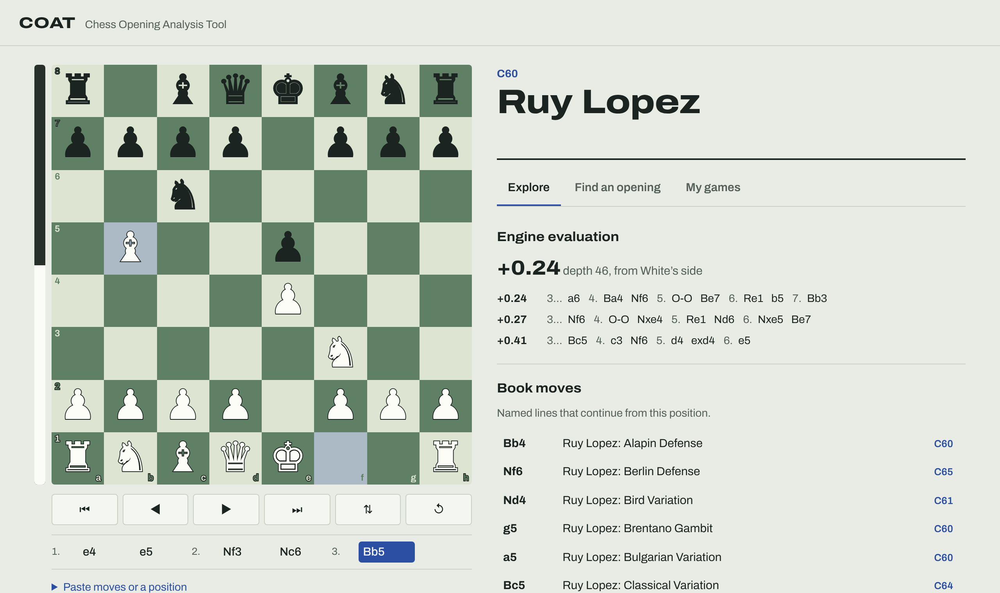

# COAT
 Chess Opening Analysis Tool

**[Try it live](https://notkornflakes.github.io/COAT/)**

COAT is a browser app for studying chess openings using open data. It has no
backend, and everything runs in your browser.



## What it does

**Explore.** Play moves on the board (click or drag) and COAT will:

- name the opening and its ECO code. It looks up positions rather than move
  orders, so transpositions are recognised.
- list the book moves: every named line that continues from the current
  position.
- show the engine evaluation and the top three lines from the Lichess cloud
  evaluation database.
- show move statistics from the master and Lichess game databases: how often
  each move is played and the White / draw / Black results.

**Find an opening.** Search the ~3,900 named openings by name or ECO code
("najdorf", "C60") and load any line onto the board.

**My games.** Enter a Lichess or Chess.com username, or upload a PGN file.
COAT downloads your recent games, works out which opening each one used, and
shows your score with each opening as White and as Black. You can group
results by opening family or by variation, and sort by "weakest first" to find
what to work on.

Lines can be shared as links. The URL hash holds the moves, for example
`#e2e4-c7c5-g1f3`.

## Data sources

| Data | Source | Notes |
| --- | --- | --- |
| Opening names, ECO codes, book lines | [lichess-org/chess-openings](https://github.com/lichess-org/chess-openings) | CC0. Bundled in `data/chess-openings/`, so it works offline |
| Engine evaluations | [Lichess cloud eval API](https://lichess.org/api#tag/Analysis) | No account needed. Only covers positions Lichess has stored, which includes most common opening positions |
| Move statistics | [Lichess opening explorer](https://lichess.org/api#tag/Opening-Explorer) | Needs a free [personal API token](https://lichess.org/account/oauth/token/create?description=COAT+opening+explorer) with no permissions. It is kept for the current tab only, unless you choose to remember it on your device |
| Your games | [Lichess game export](https://lichess.org/api#tag/Games/operation/apiGamesUser) and [Chess.com published data](https://www.chess.com/news/view/published-data-api) | Public data. No account needed |

## Development

Requires Node.js 20 or newer.

```bash
npm install
npm run dev        # start the dev server
npm test           # unit tests (vitest)
npm run build      # type-check and build to dist/
```

To refresh the opening dataset, copy the latest `*.tsv` files from
lichess-org/chess-openings into `data/chess-openings/`, then run:

```bash
npm run openings   # regenerates src/data/openings.json
```

Opening positions are pre-computed at build time, so the app does not have to
replay ~30,000 moves on startup.

### Project layout

```
data/chess-openings/   the Lichess TSV dataset (CC0)
scripts/               build-openings.mjs: TSV to pre-indexed JSON
src/chess/openings.ts  OpeningBook: name lookup, book moves, classification, search
src/api/               Lichess and Chess.com clients
src/analysis/games.ts  PGN parsing, game normalisation, per-opening stats
src/ui/                the chessboard and DOM helpers
src/main.ts            app wiring
tests/                 unit tests
```

## Deployment

Pushing to `main` deploys the app to GitHub Pages through
`.github/workflows/pages.yml`. Before the first deploy, enable Pages in the
repository settings: **Settings → Pages → Source: GitHub Actions**.

## Security

COAT has no backend and never sends your data anywhere except the Lichess
and Chess.com APIs. The built site ships a Content-Security-Policy, bundles
its own fonts, and treats all API and file data as plain text. See
[SECURITY.md](SECURITY.md) for details and for how to report a problem.

## Built with

TypeScript, [Vite](https://vite.dev/), [chess.js](https://github.com/jhlywa/chess.js)
for move rules, and [Vitest](https://vitest.dev/) for tests. The board is a
small hand-written component with no UI framework.

## Known limitations

- The move list keeps a single line. Playing a different move from an earlier
  position replaces the rest of the line instead of creating a variation.
- Pieces are drawn with Unicode chess symbols, so their look depends on your
  system fonts.
- Engine evaluations exist only for positions in Lichess's cloud database. A
  local engine (Stockfish WebAssembly) would be a natural next step.

## License

The code is released under the [MIT License](LICENSE). The opening dataset in
`data/chess-openings/` is from lichess-org/chess-openings and is dedicated to
the public domain under [CC0](data/chess-openings/COPYING.txt).
